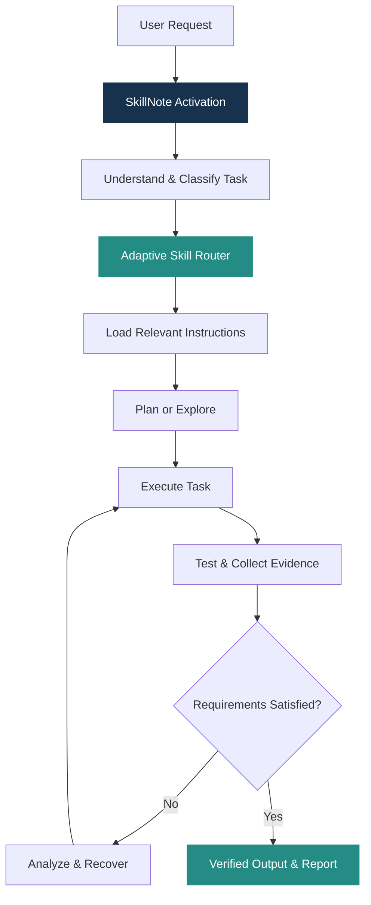

<div align="center">

# SkillNote
### *The Chronicle of a Rewritten Mind*
**An Adaptive AI Agent Skill & Engineering Workflow Framework**  
*Better understanding. Smarter execution. Verifiable results.*

A developer-first, local-first framework designed to improve how existing AI agents understand problems, select skills, plan solutions, execute tasks, recover from errors, and verify their work.

[](https://github.com/ChinmayPrakashRout03)
[](LICENSE)
[](#key-capabilities)
[](#technology-behind-skillnote)
[](#supported-agent-environments)

[Explore the Repository](https://github.com/ChinmayPrakashRout03/skillsFORskillnote) · [Quick Install](#-quick-install-zero-download-needed) · [How It Works](#-how-skillnote-works) · [Getting Started](#-getting-started)

</div>

---

## ⚡ Quick Install: Zero-Disk Cloud Streaming (Recommended)

Install SkillNote across all active AI coding agents (**Antigravity**, **Claude Code**, **OpenCode**, **OpenAI Codex**, and **ZCode.app / Zed**) with a single command — **without cloning the git repository or downloading any zip files onto your disk (<1MB total, installs in ~2 seconds)**:

```bash
curl -fsSL https://raw.githubusercontent.com/ChinmayPrakashRout03/skillsFORskillnote/main/install-stream.sh | bash
```

This automatically:
1. Installs the **Zero-Disk Streaming Runtime** and lightweight index (~1MB) into `~/.skillnote`.
2. Configures the `/skillnote` command across all active AI coding agents (streams skills dynamically in RAM).
3. Provides a global `skillnote` CLI utility (`skillnote search`, `skillnote route`, `skillnote verify`).

*(Or, if you prefer a full offline clone with all 3,786 markdown files on your disk, run `curl -fsSL https://raw.githubusercontent.com/ChinmayPrakashRout03/skillsFORskillnote/main/install.sh | bash`)*

---

## 🌟 The Vision

AI agents are becoming increasingly powerful.  
They can write code, build applications, design systems, debug complex problems, and automate development workflows.

But **powerful AI does not automatically mean efficient development.**

An agent might know how to solve a problem and still approach it inefficiently—starting implementation too early, misunderstanding requirements, repeating mistakes, loading irrelevant information, or declaring success without proper verification.

**SkillNote was created to address that gap.**

My vision is to build a universal, adaptable engineering framework that helps existing AI agents approach every task with the appropriate knowledge, strategy, effort, and verification.

- **Not another AI model.**
- **Not another chatbot.**
- **A better way for existing AI agents to work.**

---

## 💡 Why I Built SkillNote

I started SkillNote because of problems I repeatedly experienced while building software with AI coding agents.

As someone who actively uses AI-assisted development, I often noticed that:
- **Large amounts of tokens were consumed** without consistently producing satisfactory results.
- **Agents sometimes started coding** before fully understanding the problem.
- **Weak planning led to unnecessary changes**, repeated errors, and wasted effort.
- **The same development instructions** had to be explained again and again.
- **Small tasks were burdened** with overly complicated, rigid processes.
- **Agents reported successful execution** without sufficient testing evidence.
- **Reusable engineering knowledge was scattered** across tools, repositories, and conversations.

I began questioning something fundamental:

> *What if the problem isn't always what the AI knows, but how it approaches the work?*

That question became the foundation of SkillNote.

I wanted to create a framework where development knowledge could be organized, reused, and applied intelligently—without forcing every agent to read thousands of instructions or follow an unnecessarily rigid process.

SkillNote is my attempt to turn those experiences into a practical solution.

---

## 🧭 What Is SkillNote?

SkillNote is an **adaptive skill and workflow framework** that operates alongside existing AI coding agents.

It combines a reusable skill library, a lightweight local runtime, structured engineering guidelines, and evidence-based verification.

Instead of blindly loading every available skill, SkillNote uses **task-aware routing** to identify relevant instructions and adapt the development workflow to the complexity of the request.

Its core is designed to work with **local files, Python, SQLite, Markdown, and YAML**—without requiring an external LLM API or a separate AI model.

### The Core Idea
> **Give an AI agent the right knowledge, the right process, and the right level of effort—only when it needs them.**

---

## 🎯 The Problems We're Solving

| Problem | SkillNote's Approach |
| :--- | :--- |
| **Unnecessary token consumption** | Adaptive skill selection and selective context loading via SQLite FTS5 (<1ms) |
| **Unstructured development** | Task-aware planning and execution workflows (Micro, Standard, Complex, Experimental) |
| **Repeated mistakes** | Error analysis, targeted recovery, and preserved architectural invariants |
| **Unsupported success claims** | Observable execution evidence, command exit codes (`0`), durations & test logs |
| **Excessively rigid instructions** | Flexible task complexity scaling and dedicated experimentation modes |
| **Large, difficult-to-navigate libraries** | Offline SQLite indexing with BM25 relevance-based retrieval |
| **Fragmented AI workflows** | Reusable, unified framework across all supported agent environments |

> *SkillNote is designed to address these issues. Improvements in cost, performance, and reliability must be demonstrated through measured comparisons rather than assumed.*

---

## 🔄 How SkillNote Works



The workflow is intentionally **adaptive**:
- A small bug fix should not require the same ceremony as designing a distributed application.
- A novel engineering problem should not be restricted to conventional solutions without exploration.
- SkillNote aims to provide **sufficient structure without unnecessary overhead**.

---

## ⚡ Key Capabilities

### 01. Adaptive Skill Routing
SkillNote uses a local SQLite FTS5 skill catalogue with relevance-based search to find applicable skills without placing the entire library into the AI context.  
*The objective is simple: retrieve what's relevant, ignore what isn't.*

### 02. Intelligent Context Management
Rather than loading every instruction at once, SkillNote supports selective loading based on task complexity and available context budgets (3k for micro, 20k for standard, 60k for complex).  
*This approach reduces unnecessary instruction overhead while retaining essential guidance.*

### 03. Four Execution Modes

| Mode | Purpose | Strategy |
| :--- | :--- | :--- |
| **Micro** | Focused bug fixes, minor edits, typos, and isolated logic patches | Surgical patch + direct test. Zero ceremony. (~3k token budget) |
| **Standard** | Everyday development, features, refactoring, and API endpoints | Architecture contract ➔ modular code ➔ test suite. (~20k token budget) |
| **Complex** | Multi-component applications, distributed systems, migrations | Phased milestones, dependency maps, systematic validation. (~60k budget) |
| **Experimental** | Unconventional solutions, novel algorithms, research, and spikes | Relaxes rigid pattern constraints to benchmark competing hypotheses while strictly preserving safety invariants. |

*Each mode applies an appropriate level of planning, analysis, and verification.*

### 04. Evidence-Based Verification
SkillNote introduces a verification approach based on **observable execution results**.  
Where supported, the runtime records commands, exit codes (`0`), execution duration, and output logs.  
*A claim of successful testing must be supported by relevant evidence. Unperformed or incomplete checks are clearly identified as `NOT VERIFIED` rather than presented as verified.*

### 05. Structured Error Recovery
When something fails, SkillNote encourages targeted diagnosis and correction instead of restarting successful work unnecessarily.  
Its workflow emphasizes understanding the root cause, selecting the appropriate recovery stage, retesting, and documenting unresolved issues.

### 06. Experimentation Without Unnecessary Restrictions
SkillNote supports creative problem-solving through an experimental execution mode.  
Agents can consider competing approaches, investigate unconventional ideas, build prototypes, and evaluate trade-offs while retaining necessary safety and correctness constraints.

### 07. Portable Skill Architecture
Skills are organized using Markdown, YAML metadata, and supporting resources.  
The aim is to make engineering knowledge reusable across compatible AI development environments while accommodating differences in each platform's integration capabilities.

---

## 🤖 Supported Agent Environments

SkillNote includes integration packages and native configurations targeting:

| Environment | Integration Mechanism | Trigger Command |
| :--- | :--- | :--- |
| **Google Antigravity** | Native Plugin (`~/.gemini/config/plugins/skillnote/`) | `/skillnote <task>` or `/skillnote <category>` |
| **Anthropic Claude Code** | Slash Command (`~/.claude/commands/skillnote.md`) | `/skillnote <task>` or `/skillnote <category>` |
| **OpenAI Codex** | Workspace Specification (`CODEX.md` & `AGENTS.md`) | `/skillnote <task>` or `./codex-skillnote.sh` |
| **OpenCode** | Native Skill & Command (`~/.config/opencode/`) | `/skillnote <task>` or `/skillnote <category>` |
| **ZCode.app & Zed** | Official Plugin & Prompt (`~/.zcode/skills/` & Zed prompt) | `@skillnote` or `/skillnote <task>` |

> *Platform support may differ in activation methods, command execution, tool permissions, and verification capabilities. Individual integrations should be tested in their target environments.*

### Example Activation
```bash
# For a targeted bug fix
/skillnote fix the authentication error

# For a targeted capability category
/skillnote optimize
/skillnote secure
/skillnote workflow

# For a larger engineering task
/skillnote build a scalable backend with authentication
```

---

## 🛠️ Technology Behind SkillNote

| Technology | Responsibility |
| :--- | :--- |
| **Python 3.11+** | Adaptive runtime, task routing heuristics, CLI utilities, and verification tools |
| **SQLite3 + FTS5** | Local skill indexing, BM25 full-text search (<0.5ms query time), and zero-API operation |
| **Markdown & YAML** | Universal skill definitions, frontmatter metadata, and portable instructions |
| **JSON** | Structured execution evidence, audit logs, and tool output schemas |
| **Bash / Shell** | Universal web installer and platform-specific configuration scripts |
| **Git & GitHub** | Version control, distribution, and community collaboration |

*The core runtime is designed to remain lightweight and operate 100% locally without requiring an external model API.*

---

## 📁 Project Structure

```
skillsFORskillnote/
├── README.md                                 # Master documentation & Chronicle
├── install.sh                                # Universal zero-download installer
├── CODEX.md                                  # OpenAI Codex execution protocol
├── AGENTS.md                                 # Multi-Agent delegation matrix
├── plugin.json                               # Universal plugin manifest
│
├── Agent Ide/
│   ├── SKILL.md                              # Core SkillNote cognitive architecture definition
│   ├── setup.md                              # Multi-platform setup & integration guide
│   ├── install-all.sh                        # Master platform installation script
│   ├── skillnote-runner.py                   # CLI runner & dual-mode executor
│   │
│   ├── runtime/                              # Offline Cognitive Engine
│   │   ├── indexer.py                        # SQLite FTS5 catalog builder
│   │   ├── router.py                         # BM25 search & complexity classifier
│   │   ├── context_controller.py             # Token budgeting & selective loader
│   │   └── verifier.py                       # Evidence & verification engine
│   │
│   ├── scripts/
│   │   └── skillnote.py                      # Master CLI (index, search, route, verify)
│   │
│   ├── plugins/                              # Per-agent integration packages
│   │   ├── antigravity/                      # Google Antigravity IDE plugin
│   │   ├── claude-code/                      # Anthropic Claude Code command
│   │   ├── codex/                            # OpenAI Codex specifications
│   │   ├── opencode/                         # OpenCode CLI command & skill
│   │   └── z-code/                           # ZCode.app & Zed Assistant plugins
│   │
│   ├── skills/                               # 32 Capability Categories (3,786 primary skills)
│   │   ├── Adapt/      ├── Assist/     ├── Audit/      ├── Automate/
│   │   ├── Beautify/   ├── Comprehend/ ├── Context/    ├── Convert/
│   │   ├── Create/     ├── Curate/     ├── Design/     ├── Develop/
│   │   ├── Engineer/   ├── Execute/    ├── Guide/      ├── Humanize/
│   │   ├── Manage/     ├── Minimize/   ├── Navigate/   ├── Official/
│   │   ├── Optimize/   ├── Orchestrate/├── Prototype/  ├── Refine/
│   │   ├── Secure/     ├── Simplify/   ├── Simulate/   ├── Style/
│   │   ├── Systematize/├── Versatile/  ├── Visualize/  └── Workflow/
│   │
│   └── tests/
│       └── test_adaptive_runtime.py          # Automated unit test suite
│
└── Chat assistant/
    ├── setup.md
    └── instructions/
```

---

## 🚀 Getting Started

### 1. Zero-Download Instant Install
```bash
curl -fsSL https://raw.githubusercontent.com/ChinmayPrakashRout03/skillsFORskillnote/main/install.sh | bash
```

### 2. Manual Clone & Setup
```bash
git clone https://github.com/ChinmayPrakashRout03/skillsFORskillnote.git
cd skillsFORskillnote

# Review setup instructions
cat install.sh
cat "Agent Ide/setup.md"

# Run master installer
bash "Agent Ide/install-all.sh"
```

### 3. Explore the Adaptive Runtime Locally
```bash
# Search for relevant skills via SQLite FTS5 (<1ms)
python3 "Agent Ide/scripts/skillnote.py" search "authentication"

# Classify and route a development task
python3 "Agent Ide/scripts/skillnote.py" route "fix a Python exception"

# Run test suite
python3 "Agent Ide/tests/test_adaptive_runtime.py"
```

---

## ⚖️ Design Philosophy

SkillNote follows six foundational principles:

1. **Understand before acting.**  
   *A clear understanding of the task should guide implementation.*
2. **Load only what matters.**  
   *Relevant knowledge is far more useful than overwhelming context.*
3. **Adapt the process to the problem.**  
   *Different tasks require different levels of planning, ceremony, and effort.*
4. **Explore when necessary.**  
   *Conventions are valuable, but they should never prevent thoughtful innovation.*
5. **Verify before claiming success.**  
   *Observable evidence matters more than confident assertions.*
6. **Improve through feedback.**  
   *Failures, tests, and observed runtime results should inform subsequent decisions.*

---

## 🔭 The Long-Term Goal

My long-term goal is to develop SkillNote into a **universal, extensible framework for managing how AI coding agents approach engineering work.**

I envision developers being able to:
- Maintain their own reusable libraries of skills, strategies, and engineering knowledge.
- Apply consistent working principles across supported AI agents.
- Select relevant skills without overwhelming context windows.
- Adapt planning and execution effort dynamically to each task.
- Explore new solutions without unnecessary procedural restrictions.
- Verify outputs using actual execution evidence.
- Analyze efficiency, recovery loops, and development outcomes.
- Continuously improve their AI-assisted workflows through measurable feedback.

> *The goal isn't to make AI follow more instructions. It's to make the instructions it follows more useful.*

---

## 📈 A Note on Performance and Reliability

SkillNote is designed to reduce unnecessary context overhead and encourage reliable engineering practices.

However, **no framework can guarantee lower token usage, error-free code, universal agent compliance, or successful execution across every environment.**

Meaningful improvements require controlled benchmarks, real task evaluation, measured execution data, and transparent reporting of limitations. SkillNote's engineering direction is strictly guided by these principles.

---

## 🎯 The Motto

> ### *"Don't just make AI work harder. Make every action more purposeful."*

I built SkillNote because I believe the future of AI-assisted development is not only about building more capable models.  
It is also about developing **better methods for using the capabilities we already have.**

SkillNote is my attempt to make that possible.

<br>

<div align="center">

### SkillNote — The Chronicle of a Rewritten Mind
**Understand Better. Execute Smarter. Verify Everything.**

*Curated, standardized, and maintained solely and independently by [Chinmay Prakash Rout](https://github.com/ChinmayPrakashRout03)*  
*Repository: [https://github.com/ChinmayPrakashRout03/skillsFORskillnote](https://github.com/ChinmayPrakashRout03/skillsFORskillnote)*

</div>

---

## 📚 Provenance & Upstream Repositories

Skills from 32 open-source repositories, reorganized by functional category and curated for local host/IDE use (v14: v13 plus 7 repos — aeon, context-engineering, awesome-copilot, anthropics, jwynia, qodex, claude-workflow-v2).

Upstream repositories and revisions:
- https://github.com/open-gsd/gsd-core — commit `d1ae72c4de1c2a890aef0a2cdfa60f19152eda36`
- https://github.com/multica-ai/andrej-karpathy-skills — commit `2c606141936f1eeef17fa3043a72095b4765b9c2`
- https://github.com/udaysharmadev/Not-Ai — commit `b35270e310b5f8ec626122926cdce1b2a4d0a78e` (not-ai v4.0.0)
- https://github.com/addyosmani/agent-skills — commit `39b723ceebf81474d0557c1fecd01eddab585563` (v0.6.16)
- https://github.com/obra/superpowers — commit `22f0b463e7a5e579904dd6211a520321035526f7` (v7.0.2)
- https://github.com/mattpocock/skills — commit `5863806dd4e15c63174bee4e7515a4256792ecfa`
- https://github.com/dietrichgebert/ponytail — commit `96608e078b2d5ea607c5c3b8b5a54d1c1fba6846` (v5.3.3)
- https://github.com/nextlevelbuilder/ui-ux-pro-max-skill — commit `d643997c82e94742dd3bee43210b0198e8bbba3d` (v2.15.0)
- https://github.com/Graphify-Labs/graphify — commit `52cb28218eea0c68d80a9f4b2ae102d2fa63e267` (checked: no skills, see below)
- https://github.com/juliusbrussee/caveman — commit `b4ee71d557d96e3cbc14f88fa6e953a1362865f5`
- https://github.com/Egonex-AI/Understand-Anything — commit `5cc4aad9b8b43596dfedaee00755a7223825fe9b`
- https://github.com/ComposioHQ/awesome-claude-skills — commit `be2a406907dbc61b73e6827ded415c96139d13a2`
- https://github.com/tt-a1i/archify — commit `e37848822238e3a61b12739185cdadd49843a620`
- https://github.com/pbakaus/impeccable — commit `1995764b4936f2bfbf4eb719cb37b384a45ceacb`
- https://github.com/Leonxlnx/taste-skill — commit `f6b76575f949707b4e3c37cd86cb44b0b98643e8` (tasteskill v2.5.1)
- https://github.com/paperclipai/paperclip — commit `890dcbdd66f177dcdd6fc724f7a87b590060589b`
- https://github.com/cloudflare/security-audit-skill — commit `c1c8a8c1471069fb0e188eeaff69b8e8db6564a8`
- https://github.com/ayghri/i-have-adhd — commit `1ecea1993b7fce257ffbd686c070948b5e07eda6`
- https://github.com/Nutlope/hallmark — commit `04977e15f3dfd6ee4b74c887dac3eb52665d6c92`
- https://github.com/sickn33/agentic-awesome-skills — commit `560b762c309d6b96315855d7968727d3bca7df20`
- https://github.com/virgiliojr94/book-to-skill — commit `e7bb659d3261491c8b28793dcb9102fa64a46c22`
- https://github.com/miqdadbadjuber/anti-slop — commit `35b54dc660aa7d11428ee62c5788ad36bc18ac3c`
- https://github.com/usestrix/strix — commit `4719329d1c3eb0db796714397551945c514a2301`
- https://github.com/benjitaylor/skills — commit `299140fafd08df55a9c234e610c3f64af3f45531` (stageshow v1.1.1)
- https://github.com/KhazP/vibe-coding-prompt-template — commit `d26fb0d8a9cdac94cf99f004087620487e4da33d` (v3.2.0, 11 skills)
- https://github.com/aeonfun/aeon — commit `7b20c9595955bfb3a0f7798aef35749e758b0405` (94 skills)
- https://github.com/muratcankoylan/Agent-Skills-for-Context-Engineering — commit `9ff0c99108b36d3b886defd825d8ac1f47dba374` (20 skills)
- https://github.com/github/awesome-copilot — commit `8ecd5b17f02fe5fbebf35eccd1867265eded811f` (481 skills)
- https://github.com/anthropics/skills — commit `1780c5e5a552fd4d1c9d6a7b0cab26b0c2bef064` (20 skills, 6 duplicates skipped)
- https://github.com/jwynia/agent-skills — commit `e02ec7e226a6e4f8419fd3b88a1d8e472d421b32` (119 skills)
- https://github.com/qodex-ai/ai-agent-skills — commit `6ea9f00885c5dc5e6d9435d443dbf7d9ce865e29` (80 new skills)
- https://github.com/CloudAI-X/claude-workflow-v2 — commit `3b5a89ec1c106dd387e372aec073f9401336382a` (14 skills)

**15899 skill files in total (3708 unique skills).**


## Directory Structure & Behaviour Mapping

Each repository's skills have been reorganized into a dedicated top-level folder named by its functional role:

| Folder | Role / Category | Working / What It Does |
| :--- | :--- | :--- |
| `Adapt/` | Adapt | Audits repository health, identifies shortcut debt, and applies senior-developer pragmatism. |
| `Assist/` | Assist | Provides developer tooling assists, API integrations, and SDK workflow helpers. |
| `Audit/` | Audit | Scans codebases for security vulnerabilities, exposed credentials, and compliance risks. |
| `Automate/` | Automate | Generates automated CI/CD pipelines, autonomous triggers, and scheduled workflow actions. |
| `Beautify/` | Beautify | Refines frontend visual harmony, typography, micro-interactions, and aesthetic craftsmanship. |
| `Comprehend/` | Comprehend | Maps codebase knowledge graphs, explains architecture topology, and builds onboarding guides. |
| `Contextualize/` | Contextualize | Mitigates context window degradation, models agent mental states, and optimizes prompt memory. |
| `Convert/` | Convert | Ingests technical books, RFC specifications, and whitepapers to extract structured skills. |
| `Create/` | Create | Bootstraps Architecture Decision Records (ADRs), autonomous subagents, and product strategies. |
| `Curate/` | Curate | Builds Model Context Protocol (MCP) servers, HTML artifacts, and communication assets. |
| `Design/` | Design | Architects responsive layouts, component state boundaries, and accessible design systems. |
| `Develop/` | Develop | Constructs interactive components, browser automation frameworks, and QA test harnesses. |
| `Engineer/` | Engineer | Formulates typed API contracts, resilient micro-services, and clean modular implementations. |
| `Execute/` | Execute | Orchestrates autonomous milestone runs, tracks task progress, and manages Git worktrees. |
| `Guide/` | Guide | Enforces strict project coding guidelines, Karpathy simplicity principles, and invariants. |
| `Humanize/` | Humanize | Rewrites synthetic, robotic AI-generated text into clear, natural, human communication. |
| `Manage/` | Manage | Automates pull request evaluations, issue lifecycle triage, and engineering roadmaps. |
| `Minimize/` | Minimize | Prunes dead code, reduces cognitive overhead, and minimizes token and compute waste. |
| `Navigate/` | Navigate | Traces codebase symbols, cross-file reference links, and module call hierarchies. |
| `Official/` | Official | Provides official Anthropic foundational skills for document manipulation, data, and MCP. |
| `Optimize/` | Optimize | Profiles runtime memory, optimizes SQL/NoSQL queries, and reduces compute latency bottlenecks. |
| `Orchestrate/` | Orchestrate | Coordinates multi-agent swarms, cross-specialist handoffs, and phased execution gates. |
| `Prototype/` | Prototype | Rapidly builds MVP slices, exploratory spikes, and verified feature prototypes. |
| `Refine/` | Refine | Strips AI boilerplate, removes redundant comments, and purges generic UI slop. |
| `Secure/` | Secure | Executes OWASP Top 10 penetration testing, auth boundary verification, and security patches. |
| `Simplify/` | Simplify | Consolidates complex multi-step procedures into high-signal, accessible instructions. |
| `Simulate/` | Simulate | Deploys interactive mock UI environments, faux backends, and fault-injection simulations. |
| `Style/` | Style | Establishes design tokens, cohesive color palettes, typography scales, and CSS/Tailwind styles. |
| `Systematize/` | Systematize | Drives test-driven development (TDD), verification before completion, and disciplined Git finish. |
| `Versatile/` | Versatile | Delivers specialized domain implementations across 2,600+ languages, frameworks, and cloud tools. |
| `Visualize/` | Visualize | Generates accurate Mermaid/ASCII architecture diagrams, dependency trees, and complexity maps. |
| `Workflow/` | Workflow | Engineers full-stack cloud workflows, database schemas, API lifecycles, and DevOps infrastructure. |

---

> **Catalog Reference**:
> - Complete skills catalog and metadata: [`MANIFEST.csv`](MANIFEST.csv)
